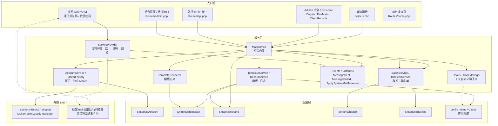

# CmsPro SMTP邮箱 · 特性清单

> 版本：1.0.3 | 更新日期：2026-11-06
> 应用版本：1.0.3 | 应用 ID：`cmspro.smtpmail`

本清单依据 `manifest.json` 与应用内真实源码整理，系统列出本应用实际覆盖的 CmsPro v5 框架特性，并逐项标注实现文件位置，作为应用开发、验收与后续扩展的参考基准。

---

## 一、应用基本信息

| 项目 | 取值 | 来源 |
|------|------|------|
| 应用 ID | `cmspro.smtpmail` | `manifest.json` `id` |
| 应用名称 | SMTP邮箱 | `manifest.json` `name` |
| 版本 | `1.0.3` | `manifest.json` `version` |
| 应用目录 | `code/app/Apps/CmsproSmtpmail/` | 磁盘目录 |
| 命名空间 | `App\Apps\CmsproSmtpmail\*` | 各 PHP 文件 `namespace` |
| 服务提供者 | `ServiceProvider`（`manifest.json` `providers`） | `ServiceProvider.php` |
| 钩子注册类 | `Hooks`（`manifest.json` `hooks`） | `Hooks.php` |
| 安装脚本 | `Install`（`manifest.json` `install`） | `Install.php` |
| 运行依赖 | PHP `>=8.3`、CmsPro `>=5.0.0` | `manifest.json` `require` |
| 应用依赖 | `dependencies.app_ids` 为空，无强/弱应用依赖 | `manifest.json` `dependencies` |
| 图标 | `fa fa-envelope-o` | `manifest.json` `icon` |
| 作者 | CmsPro（`https://www.cmspro.cn`） | `manifest.json` `author` / `author_url` |

---

## 二、五大隔离

应用严格遵循 CmsPro v5 应用隔离规范，五类资源均限定在应用自有边界内，不侵入框架文件。

| 隔离维度 | 本应用约定 | 实现文件位置 | 说明 |
|----------|-----------|--------------|------|
| 目录隔离 | 全部交付物位于 `app/Apps/CmsproSmtpmail/` 根目录内 | `CmsproSmtpmail/`（Controllers、Services、Routes、Views、Models、Migrations、Config、Console、Events、Listeners、Jobs、Mail、Exceptions、doc 等） | `ServiceProvider::APP_PATH = 'app/Apps/CmsproSmtpmail'`，所有路径均经 `base_path()` 拼接 |
| 命名空间隔离 | `App\Apps\CmsproSmtpmail\*` | 全部 PHP 类文件 | 服务类在 `Services\`、模型在 `Models\`、事件在 `Events\`、命令在 `Console\Commands\`、监听器在 `Listeners\` |
| 数据库隔离 | 表名统一前缀 `app_cmspro_smtpmail_` | `Migrations/` 下 5 个迁移、`Models/` 下 5 个模型 | 5 张业务表互不引用框架表；迁移 `up()` 先 `Schema::hasTable()` 幂等判断，`down()` 用 `dropIfExists` |
| 视图隔离 | 视图命名空间 `cmspro.smtpmail` | `ServiceProvider::loadViews()`（`loadViewsFrom`）、`Views/` 目录 | 引用形如 `cmspro.smtpmail::Admin.send.index`；覆盖视图单独放在 `Views/Override/` |
| 配置隔离 | 数据库键 `app_cmspro_smtpmail_<key>`、运行时命名空间 `apps.cmspro.smtpmail` | `helpers.php` `smtpmail_config()`、`Config/smtpmail.php`、`Install.php` `CODE_PREFIX` | 运行时统一经 `smtpmail_config()` 读取，禁止直接使用 `config()` 读取应用配置 |

---

## 三、三终端与路由系统

本应用仅提供「后台管理端 + 外部 HTTP 接口 + 前台退订页」三终端，`manifest.json` 未声明 `user_menus`，不含用户端。

| 终端 | 路由前缀 | 中间件 | 路由文件 | 声明位置 | 注册位置 |
|------|----------|--------|----------|----------|----------|
| 后台管理端（页面 + 数据接口） | `admin/cmspro/smtpmail` | `['web', 'auth:admin', 'permission:admin']` | `Routes/admin.php` | `manifest.json` `menus`（8 个子菜单） | `ServiceProvider::registerRoutes()` |
| 外部 HTTP 接口 | `api/smtpmail` | `['throttle:60,1']` | `Routes/api.php` | `manifest.json` `config_groups.api`（`api_enabled` / `api_token`） | `ServiceProvider::registerRoutes()` |
| 前台退订页 | `smtpmail` | `['web']`（公开访问） | `Routes/home.php` | `manifest.json` `home_routes`（`/smtpmail/unsubscribe` → 邮件退订） | `ServiceProvider::registerRoutes()` |

| 路由约定 | 实现位置 | 说明 |
|----------|----------|------|
| 页面路由挂根、数据接口挂 `api/` 子前缀 | `Routes/admin.php` `Route::prefix('api')->name('api.')` | 后台数据接口统一命中系统 CSRF 白名单机制 |
| 所有 `{id}` 加 `whereNumber` 约束 | `Routes/admin.php` | 静态路径一律置于动态路径之前 |
| 路由命名 `cmspro.smtpmail.admin.*` / `cmspro.smtpmail.api.*` / `cmspro.smtpmail.home.*` | `ServiceProvider::registerRoutes()` 的 `->name()` | 便于 `route()` 生成 URL |
| 接口限流 `throttle:60,1` | `ServiceProvider::registerRoutes()` | 外部接口每分钟最多 60 次 |
| 外部接口令牌校验 | `Controllers/Api/ApiController.php` | 请求头 `X-Smtpmail-Token`，由 `authorizeRequest()` 校验；开关与令牌取自 `api_enabled` / `api_token` |

---

## 四、数据层（5 张表）

| 表名 | 模型 | 迁移文件（`Migrations/`） | 用途 |
|------|------|---------------------------|------|
| `app_cmspro_smtpmail_accounts` | `Models/SmtpmailAccount.php` | `2026_11_05_000001_create_app_cmspro_smtpmail_accounts_table.php` | 发信账号（SMTP 主机/端口/加密方式/凭据/发件人/限流/默认标记） |
| `app_cmspro_smtpmail_templates` | `Models/SmtpmailTemplate.php` | `2026_11_05_000002_create_app_cmspro_smtpmail_templates_table.php` | 邮件模板（编码、主题、HTML/纯文本双正文、变量定义、绑定账号） |
| `app_cmspro_smtpmail_records` | `Models/SmtpmailRecord.php` | `2026_11_05_000003_create_app_cmspro_smtpmail_records_table.php` | 发送记录/日志（渲染快照、收件人、状态、重试、错误、来源） |
| `app_cmspro_smtpmail_batches` | `Models/SmtpmailBatch.php` | `2026_11_05_000004_create_app_cmspro_smtpmail_batches_table.php` | 批量群发任务（总数/成功数/失败数/进度） |
| `app_cmspro_smtpmail_blacklist` | `Models/SmtpmailBlacklist.php` | `2026_11_05_000005_create_app_cmspro_smtpmail_blacklist_table.php` | 退订黑名单（邮箱、原因、退订令牌、生效状态） |

| 数据层特性 | 实现文件位置 | 说明 |
|------------|--------------|------|
| 模型统一继承 `App\Models\BaseModel` | `Models/*.php` | 时间戳字段为 `create_time` / `update_time`（`CREATED_AT` / `UPDATED_AT`） |
| 发送记录状态机（7 态） | `Models/SmtpmailRecord.php` 常量 `STATUS_*` | `pending` → `queued`/`scheduled` → `sending` → `success`/`failed`，`canceled`，见 `statusMap()` |
| 批量任务状态机（4 态） | `Models/SmtpmailBatch.php` 常量 `STATUS_*` | `pending` / `running` / `finished` / `canceled` |
| JSON 字段自动转型 | `Models/SmtpmailRecord.php` `$casts`、`Models/SmtpmailTemplate.php` `$casts` | `to_addresses`/`cc`/`bcc`/`reply_to`/`attachments`/`headers`/`variables` 均为 `array` |
| 日期统一格式 `Y-m-d H:i:s` | `Models/*.php` `$casts` 的 `datetime:Y-m-d H:i:s` | 与 `Services`、`Console` 写入格式一致 |
| 敏感字段隐藏 | `Models/SmtpmailAccount.php` `$hidden = ['password']` | 密码密文不出模型响应，解密统一走 `AccountService::decryptPassword()` |
| 查询作用域 | `Models/*.php` `scopeEnabled` / `scopeKeyword` / `scopeOfStatus` | 供各 Service 复用 |
| 结果快照输出 | `Models/SmtpmailRecord.php` `toSummaryArray()` / `toDetailArray()` | 供后台列表与详情视图使用 |

---

## 五、钩子系统

框架钩子能力由 `App\Services\HookManager` 提供（`registerAction` / `registerFilter` / `doAction` / `applyFilter`，第 4 参数为 `app_id`，供应用禁用/卸载时批量摘除）。本应用既是钩子**消费者**，也是 4 个自定义钩子点的**提供者**。

| 钩子点 | 类型 | 触发位置 | 载荷 / 参数 | 返回约定 |
|--------|------|----------|-------------|----------|
| `cmspro.smtpmail.before_send` | Filter | `Services/MailService.php::sendRaw()` | 值为 `$payload` 数组，附传 `$options` | 必须返回数组；非数组返回值被忽略 |
| `cmspro.smtpmail.should_send` | Filter | `Services/MailService.php::sendRaw()` | 值为 `true`，附传 `$payload` | 返回 `false` 拦截发送（记录状态 `canceled`） |
| `cmspro.smtpmail.sent` | Action | `Services/MailService.php::deliver()` | `int $recordId, SmtpmailRecord $record` | 无返回值 |
| `cmspro.smtpmail.failed` | Action | `Services/MailService.php::fail()` | `int $recordId, string $error` | 无返回值 |

| 钩子注册特性 | 实现文件位置 | 说明 |
|--------------|--------------|------|
| 双通道去重注册 | `ServiceProvider::registerHooks()`、`Hooks.php::register()` | `manifest.json` `hooks` 字段 + ServiceProvider 双通道；先 `getRegisteredHooks(APP_ID)` 判重，避免重复注册 |
| 内置监听：`app.disabled` → 清配置缓存 | `Hooks.php::onAppDisabled()` | 应用禁用时调用 `smtpmail_forget_config_cache()`，避免接管开关残留 |
| 内置监听：`cmspro.smtpmail.failed` → 写系统日志 | `Hooks.php::onSendFailed()` | `Log::warning('SMTP邮箱发送失败', ...)`，含 `record_id` 与 `error` |
| 第 4 参数传 `app_id` | `Hooks.php` `self::APP_ID = 'cmspro.smtpmail'` | `registerAction(..., 10, self::APP_ID)`，卸载时由 `removeHooksByApp()` 摘除 |
| 单回调异常隔离 | `Services/MailService.php` `fireAction()` / `applyFilter()` 外层 `try-catch`、`HookManager` 内部隔离 | 单个钩子异常不阻断发信与后续回调 |

---

## 六、配置系统三向同步

| 环节 | 实现文件位置 | 说明 |
|------|--------------|------|
| 唯一基准 | `manifest.json` `config_groups` | 3 个配置组共 12 个配置项，是后台可改配置的声明来源 |
| 代码兜底默认值 | `Config/smtpmail.php` | 与 `config_groups.items` 一一对应，键名与默认值一致 |
| 数据库落库 | `Install.php::seedDefaultConfigs()` | 写入 `config_groups` / `config_items`，code 规则 `app_cmspro_smtpmail_<key>` |
| 三向同步规则 | `Install.php::seedDefaultConfigs()` | 新增写默认值；已有仅更新结构、保留用户 `value`；已从 manifest 移除的清理 DB 残留；末行清理空配置组 |
| 运行时读取 | `helpers.php::smtpmail_config()` | 优先 `ConfigItem`（`app_cmspro_smtpmail_<key>`），回退 `config('apps.cmspro.smtpmail.<key>')`，`Cache::remember` 缓存 3600 秒 |
| 配置缓存清理 | `helpers.php::smtpmail_forget_config_cache()`、`Install.php::forgetConfigCache()`、`AccountService::forgetCache()` | 清 `smtpmail:config:*` 与 `smtpmail:takeover:account`；后台设置保存、账号变更、应用禁用、安装/升级/卸载时调用 |
| 配置合并 | `ServiceProvider::register()` `mergeConfigFrom()` | 把 `Config/smtpmail.php` 合并到 `apps.cmspro.smtpmail` 命名空间 |

| 配置组 | 标题 | 配置项数 | 名称（`name`） |
|--------|------|----------|----------------|
| `general` | 发信基础设置 | 8 | `takeover_system_mail`、`use_queue`、`max_retries`、`retry_delay`、`rate_limit`、`log_retention_days`、`site_name`、`enable_blacklist` |
| `api` | 接口访问设置 | 2 | `api_enabled`、`api_token` |
| `system_templates` | 系统邮件模板映射 | 2 | `template_verify_code`、`template_password_reset` |

---

## 七、权限（6 个）

`manifest.json` `permissions` 共声明 6 个权限点，安装后写入系统权限表，由后台 RBAC 分配。

| 权限 code | 权限名称 | 对应后台能力 |
|-----------|----------|--------------|
| `cmspro.smtpmail.send` | SMTP邮箱-发送邮件 | 发送邮件页 |
| `cmspro.smtpmail.template` | SMTP邮箱-模板管理 | 邮件模板页 |
| `cmspro.smtpmail.account` | SMTP邮箱-账号管理 | 发信账号页 |
| `cmspro.smtpmail.record` | SMTP邮箱-发送日志 | 发送日志页 |
| `cmspro.smtpmail.batch` | SMTP邮箱-批量群发 | 批量群发页 |
| `cmspro.smtpmail.setting` | SMTP邮箱-应用设置 | 应用设置页 |

> 说明：`manifest.json` 未为「黑名单」「统计看板」单独声明权限点，二者由后台 `permission:admin` 中间件与菜单可见性控制；此处按权限清单实际数量如实列出 6 个。

---

## 八、菜单与 home_routes

| 层级 | code | 标题 | path | order | 实现位置 |
|------|------|------|------|-------|----------|
| 一级菜单 | `admin_cmspro_smtpmail` | SMTP邮箱 | 不声明 path（目录） | 63 | `manifest.json` `menus[0]` |
| 子菜单 | `admin_cmspro_smtpmail_send` | 发送邮件 | `/admin/cmspro/smtpmail/send` | 1 | `Routes/admin.php` `send.index` |
| 子菜单 | `admin_cmspro_smtpmail_templates` | 邮件模板 | `/admin/cmspro/smtpmail/templates` | 2 | `Routes/admin.php` `templates.index` |
| 子菜单 | `admin_cmspro_smtpmail_accounts` | 发信账号 | `/admin/cmspro/smtpmail/accounts` | 3 | `Routes/admin.php` `accounts.index` |
| 子菜单 | `admin_cmspro_smtpmail_records` | 发送日志 | `/admin/cmspro/smtpmail/records` | 4 | `Routes/admin.php` `records.index` |
| 子菜单 | `admin_cmspro_smtpmail_batches` | 批量群发 | `/admin/cmspro/smtpmail/batches` | 5 | `Routes/admin.php` `batches.index` |
| 子菜单 | `admin_cmspro_smtpmail_blacklist` | 黑名单 | `/admin/cmspro/smtpmail/blacklist` | 6 | `Routes/admin.php` `blacklist.index` |
| 子菜单 | `admin_cmspro_smtpmail_dashboard` | 统计看板 | `/admin/cmspro/smtpmail/dashboard` | 7 | `Routes/admin.php` `dashboard.index` |
| 子菜单 | `admin_cmspro_smtpmail_settings` | 应用设置 | `/admin/cmspro/smtpmail/settings` | 8 | `Routes/admin.php` `settings.index` |

| 前台路由 | 标题 | 实现位置 |
|----------|------|----------|
| `/smtpmail/unsubscribe` | 邮件退订 | `manifest.json` `home_routes`；`Routes/home.php` `unsubscribe`；`Views/Home/unsubscribe.blade.php` |

> 菜单目录不声明 `path` 且 `code` 全局唯一，子菜单 `code` 与目录 `code` 不重复，符合规范第 13 章菜单 `code` 约定。

---

## 九、安装 / 卸载 / 升级

| 动作 | 入口 | 实现文件位置 | 行为 |
|------|------|--------------|------|
| 安装 `install()` | `manifest.json` `install` → `Install` | `Install.php::install()` | `runMigrations()` 兜底执行 5 个迁移 → `seedDefaultConfigs()` 三向同步 12 项配置 → `seedBuiltinTemplates()` 初始化 2 套内置模板 |
| 卸载 `uninstall()` | 框架应用管理 | `Install.php::uninstall()` | `rollbackMigrations()` 逆序 `down()` 删 5 表并清 `migrations` 记录 → `removeConfigs()` 清配置组/项 → `forgetConfigCache()` 清缓存 |
| 升级 `upgrade(string $fromVersion, string $toVersion)` | 框架应用管理 | `Install.php::upgrade()` | 重新执行迁移兜底、配置三向同步（保留用户 value）、补齐内置模板、清缓存 |
| 迁移兜底 | `runMigrations()` / `rollbackMigrations()` | `Install.php` | 直接 `require` 迁移文件调用 `up()`/`down()`，并写/删 `migrations` 表记录，规避 Windows 路径解析问题 |
| 内置模板初始化 | `seedBuiltinTemplates()` | `Install.php` | 仅创建、不覆盖用户已编辑内容；`verify_code`、`password_reset` 均 `is_system=1`、`category=system`、`status=1` |

---

## 十、视图规范

| 视图区域 | 实现文件位置 | 规范说明 |
|----------|--------------|----------|
| 后台列表/表单分离 | `Views/Admin/{send,templates,accounts,records,batches,blacklist,dashboard,settings}/` | 按功能模块建小写复数子目录，列表 `index.blade.php`、表单 `form.blade.php`；`records/` 另有 `detail.blade.php` |
| 视图命名空间 | `ServiceProvider::loadViews()` | `loadViewsFrom(base_path(APP_PATH.'/Views'), 'cmspro.smtpmail')` |
| 前台独立完整页面 | `Views/Home/unsubscribe.blade.php` | 自带 `<!DOCTYPE html>`/`<head>`/`<body>` 与内联样式，不继承 `layouts.*`，符合 iframe 多标签页规范 |
| 系统邮件覆盖视图 | `Views/Override/emails/register-code.blade.php`、`Views/Override/emails/password-reset-code.blade.php` | 仅在「接管系统邮件」开启时被 `prependLocation` 优先命中，调用 `smtpmail_render_system()` 渲染本应用模板 |
| Blade 与 Layui 冲突规避 | `Views/**/*.blade.php` | 页面 JS 模板块用 `@verbatim` 包裹，避免 `{{# }}` 被 Blade 解析 |

---

## 十一、接管系统邮件的实现方式

本应用可在**零框架文件改动**的前提下接管系统自带的注册验证码、找回密码邮件。

| 步骤 | 实现 | 实现文件位置 |
|------|------|--------------|
| 1. 开关判断 | `(string) smtpmail_config('takeover_system_mail', '0') !== '1'` 时直接返回 | `ServiceProvider::registerTakeover()` |
| 2. 默认账号检查 | `AccountService::defaultAccount()` 返回 `null` 时不接管，系统邮件保持原生行为 | `ServiceProvider::registerTakeover()`、`Services/AccountService.php::defaultAccount()` |
| 3. 运行时注入 mail 配置 | `config([...])` 内存覆盖 `mail.default`、`mail.mailers.smtp.*`、`mail.from.*`；密码经 `decryptPassword()` 解密；不改任何配置文件 | `ServiceProvider::registerTakeover()` |
| 4. 视图优先路径 | `app('view')->getFinder()->prependLocation(.../Views/Override)`，替换 `emails.register-code` / `emails.password-reset-code` | `ServiceProvider::registerTakeover()`、`Views/Override/emails/*.blade.php` |
| 5. 主题/正文改写 | `MessageSending` 事件监听 `ApplySystemMailTakeover::handle()`，从 `TakeoverContext::consume()` 取渲染结果写回 Symfony 消息 | `ServiceProvider::registerEvents()`、`Listeners/ApplySystemMailTakeover.php`、`Services/TakeoverContext.php`、`helpers.php::smtpmail_render_system()` |
| 6. 关闭即回退 | 关闭开关后不做任何注入，系统邮件回归框架原生 `Mail::send` 行为 | `ServiceProvider::registerTakeover()` |

| 隔离保证 | 实现文件位置 | 说明 |
|----------|--------------|------|
| 应用自身发信不走框架 mail 配置 | `Services/MailerFactory.php::make()` / `buildTransport()` | 按账号参数直接构造 Symfony `EsmtpTransport` 并包成独立 `Illuminate\Mail\Mailer`，多账号并存且不影响框架全局邮箱配置 |
| 接管上下文逐请求隔离 | `ServiceProvider::register()` `singleton(TakeoverContext::class)`、`Services/TakeoverContext.php` | 避免常驻进程（Octane）跨请求污染；`consume()` 读后即清空 |
| 系统邮件视图变量 | `Views/Override/emails/*.blade.php` | 传入 `code` / `minutes` / `nickname`，模板编码取自 `template_verify_code` / `template_password_reset` |

---

## 十二、应用架构图

---

## 十三、事件、队列与调度

| 能力 | 实现文件位置 | 说明 |
|------|--------------|------|
| Laravel 事件 `MessageSent` | `Events/MessageSent.php` | 构造持有 `public SmtpmailRecord $record`，在 `MailService::deliver()` 成功后 `event()` 派发 |
| Laravel 事件 `MessageFailed` | `Events/MessageFailed.php` | 构造持有 `public SmtpmailRecord $record, public string $error`，在 `MailService::fail()` 派发（含可重试失败） |
| 队列任务 | `Jobs/SendMailJob.php` | `ShouldQueue`，`tries=1`、`timeout=120`，`handle()` 调用 `MailService::deliver()`；重试由应用按 `max_retries` / `retry_delay` 统一安排 |
| 命令 `smtpmail:dispatch-due` | `Console/Commands/DispatchDueMails.php` | 派发到期与待重试邮件，支持 `--limit`（1~500，默认 100）；回收超时 10 分钟的 `queued` 记录 |
| 命令 `smtpmail:clean-records` | `Console/Commands/CleanRecords.php` | 按 `log_retention_days` 清理过期成功/失败/取消记录 |
| 调度注册 | `ServiceProvider::registerSchedule()` | `smtpmail:dispatch-due` → `everyMinute()`；`smtpmail:clean-records` → `dailyAt('03:20')`，均 `withoutOverlapping()`；由运维既有 `artisan schedule:run` 驱动，不侵入框架 `routes/console.php` |

---

## 版本历史

| 版本 | 日期 | 说明 |
|------|------|------|
| 1.0.3 | 2026-11-06 | 模板分类管理与表单分类下拉；模板正文三态编辑器（代码/可视化/预览）；预览与测试改变量表单；内置变量中文名后端统一下发；发送页附件支持从附件管理选择；`welcome`/`notice` 升级为内置模板；新增「欢迎邮件」开关（`welcome_mail`，注册成功后自动发送）；设置页 Tab 分类与接口文档 Tab；修复记录页字段错位与详情留白 |
| 1.0.2 | 2026-11-06 | 发送页三项完善：变量中文 label、高级选项折叠、附件上传/路径 Tab 二选一与上传接口 |
| 1.0.1 | 2026-11-05 | 验收整改：设置白名单与密钥明文回显、`ApiResponse` 统一响应、`ForceJsonResponse` 强制 JSON 中间件、Service 更新入口必填兜底校验、视图语义色板/系统字体/弹窗配置/防重复提交、路由参数去 `int` 类型提示、应用级测试 41→55 |
| 1.0.0 | 2026-11-05 | 首个版本：五大隔离、后台/外部接口/前台退订三终端、5 张表数据层、4 个钩子点与 2 个 Laravel 事件、配置三向同步、6 个权限、安装/卸载/升级、可视化模板、系统邮件运行时代理接管、队列与定时调度 |
